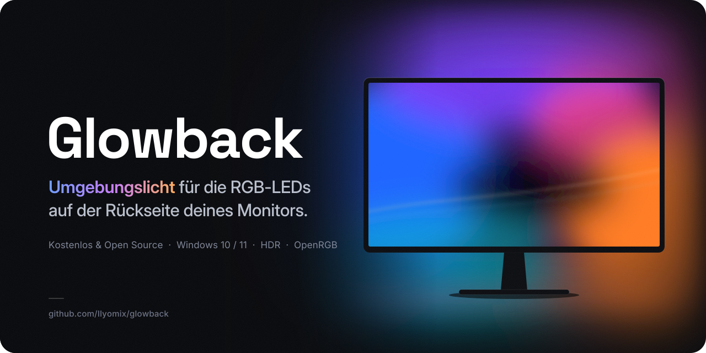

  

  <a href="README.md">English</a> · <a href="README.fr.md">Français</a> · <a href="README.es.md">Español</a> · <b>Deutsch</b> · <a href="README.it.md">Italiano</a> · <a href="README.pt.md">Português</a>

<h1 align="center">Glowback: Umgebungslicht für Monitore mit RGB-LEDs auf der Rückseite</h1>

  <b>Kostenlose Open-Source-Bildschirmsynchronisation für die RGB-LEDs auf der Rückseite deines Monitors.</b> 
  Jede LED folgt in Echtzeit dem Bildausschnitt direkt vor ihr. 
  Funktioniert mit Geräten für die <b>dynamische Beleuchtung von Windows 11</b> und <b>OpenRGB</b>. Ohne LED-Streifen, Kamera oder Hersteller-App.

  
  
  
  

---

Immer mehr Gaming-Monitore haben RGB-LEDs auf der Rückseite, doch ihre Software bietet nur statische, pulsierende oder Regenbogen-Effekte. **Glowback** macht daraus **echtes Umgebungslicht**: Es erfasst den Bildschirm 30-mal pro Sekunde und gibt **jeder LED ihre eigene Farbe**, genommen vom Bildrand direkt vor ihr. Ein Sonnenuntergang links im Bild färbt die linke Wand orange.

Glowback ist an keine Marke gebunden: Es steuert jedes Gerät, das die **dynamische Beleuchtung von Windows** (der HID-LampArray-Standard) oder **[OpenRGB](https://openrgb.org)** ansprechen kann: Monitore, LED-Streifen, PC-Gehäuse, Lampen.

## ✨ Funktionen

- 🎯 **Eine Zone pro LED**, projiziert auf den nächstgelegenen Bildschirmrand. Alternativ ein Modus mit einer Durchschnittsfarbe.
- 🎬 **Filme, Spiele, HDR**: GPU-Erfassung (DXGI) im Vollbild, HDR-fähig, **schwarze Balken werden ignoriert**.
- 💡 **Helle, natürliche Farben**, auch in dunklen Szenen.
- 🪟 **Eine echte Windows-App**: ein Fenster mit einer Live-Vorschau deiner LEDs, schnelle Einstellungen über das Symbol neben der Uhr, Installer, Startmenü, Start mit Windows und saubere Deinstallation unter *Einstellungen → Apps*.
- ⏳ **Synchronisieren, wann du willst**: solange eine App läuft, im Vordergrund oder im Vollbild ist, auf dem Bildschirm deiner Wahl. Den Rest der Zeit behalten die LEDs ihren eigenen Effekt.
- 🔄 **Update-Hinweise** einmal am Tag (abschaltbar).
- 🏠 **Home Assistant, Google Assistant, Alexa und Siri**: Glowback erscheint als Licht, steuerbar über Dashboards, Automationen oder per Sprache.
- 🌍 **6 Sprachen**, passend zur Windows-Sprache.
- 🔌 **Plug and play**: findet Geräte mit dynamischer Beleuchtung und OpenRGB automatisch.
- 🪶 **Leichtgewichtig**: etwa 0,5 ms CPU pro Bild.

## 🚀 Installation

1. **Verbinde das USB-Upstream-Kabel des Monitors** mit dem PC (USB-B oder USB-C).
2. **Schalte die dynamische Beleuchtung von Windows für dieses Gerät aus**: *Einstellungen → Personalisierung → Dynamische Beleuchtung → dein Gerät → „Dynamische Beleuchtung auf meinen Geräten verwenden“ → Aus*.
3. **Lade [GlowbackSetup.exe](https://github.com/Ilyomix/glowback/releases/latest/download/GlowbackSetup.exe) herunter** und folge dem Assistenten (keine Administratorrechte nötig).

> Windows SmartScreen warnt eventuell vor einem unbekannten Herausgeber, weil die App noch nicht signiert ist: *Weitere Informationen → Trotzdem ausführen*. [Richtlinie zur Codesignierung](CODE_SIGNING.md) · [Datenschutz](PRIVACY.md)

Ausrichtung der LEDs prüfen: *Startmenü → Glowback-Werkzeuge → LEDs testen* (links rot, rechts blau).

## ✅ Funktioniert mein Monitor?

Ja, wenn **eine** dieser Bedingungen erfüllt ist:

1. **Er erscheint in Windows** unter *Einstellungen → Personalisierung → Dynamische Beleuchtung*.
2. **Er wird von [OpenRGB](https://openrgb.org) unterstützt**: OpenRGB mit seinem SDK-Server starten, Glowback erkennt ihn automatisch.
3. **Weder noch?** Einen LED-Streifen mit einem 5-$-RP2040-Board nachrüsten: [DIY-Anleitung](docs/DIY-LED-strip.md) (auf Englisch).

Getestet mit: AOC AGON PRO AG276QZD2 (47 LEDs). Läuft es auf deinem Monitor? [Sag uns Bescheid](https://github.com/Ilyomix/glowback/issues/new?template=device-report.yml).

## 🪟 Die App

Startest du Glowback über das Startmenü, öffnet sich sein Fenster: **Umgebungslicht** (Live-Vorschau, an/aus, Modus, Helligkeit), **Wann synchronisieren**, **Home Assistant**, **Einstellungen** (Start mit Windows, Updates, Sprache) und **Info**. Schließt du es, läuft Glowback im Hintergrund weiter: Ein Doppelklick auf das Symbol neben der Uhr öffnet es wieder, ein einfacher Klick das Schnellmenü.

## ⏳ Wann synchronisieren

Standardmäßig folgt Glowback dem Bildschirm immer. Auf der Seite **Wann synchronisieren** fügst du Bedingungen hinzu (eine App; wann: läuft, im Vordergrund oder im Vollbild; und auf welchem Bildschirm): Glowback folgt dem Bildschirm dann nur, solange eine davon erfüllt ist, sonst zeigen die LEDs ihren eigenen Effekt. Zum Beispiel: VLC im Vordergrund oder eine beliebige App im Vollbild auf dem LED-Bildschirm. [Ausführliche Anleitung (Englisch)](README.md#-when-to-sync).

## 🏠 Home Assistant und Google Assistant

Glowback kann in Home Assistant als Licht erscheinen (an/aus, Helligkeit und Modus), steuerbar über Dashboards, Automationen, Google Assistant, Alexa und Siri (Apple Home, über die Integration HomeKit Bridge von Home Assistant). Installiere in Home Assistant die App **Mosquitto broker**, klicke dann im Glowback-Panel auf **Home Assistant** und gib Adresse, Benutzer und Passwort ein. [Ausführliche Anleitung (Englisch)](README.md#-home-assistant--google-assistant).

## 🗑️ Deinstallieren

- **Installer**: *Einstellungen → Apps → Installierte Apps → Glowback → Deinstallieren*. Die LEDs kehren zum Effekt des Geräts zurück.
- **Python-Version**: `glowback --uninstall`, dann `pip uninstall glowback`.
- **Portabel**: `glowback.exe --uninstall`, dann die .exe-Dateien löschen.

## ❓ FAQ

**Welche Monitore werden unterstützt?** Jeder Monitor, dessen RGB-Beleuchtung auf der Rückseite über die dynamische Beleuchtung von Windows oder OpenRGB steuerbar ist. Prüfen mit `glowback --list`.

**Funktioniert es mit HDR, Spielen und Filmen im Vollbild?** Ja. DRM-geschützte Inhalte erscheinen für alle Aufnahmetools meist schwarz.

**Nichts leuchtet.** USB-Kabel des Monitors prüfen, RGB im Monitormenü aktivieren und die dynamische Beleuchtung von Windows für das Gerät ausschalten.

**Die Farben sind auf der falschen Seite.** *LEDs testen* verwenden; sind links und rechts vertauscht, `--mirror` hinzufügen.

Kommandozeilenoptionen und technische Details: [englische README](README.md#%EF%B8%8F-command-line).

## ⭐ Unterstützung

Wenn Glowback deinen Schreibtisch erhellt, **gib dem Repository einen Stern**: So finden es andere Besitzer von RGB-Monitoren.

---

Ambilight ist eine Marke von Koninklijke Philips N.V. / TP Vision. Glowback ist ein unabhängiges Open-Source-Projekt ohne Verbindung zu ihnen.

MIT © [Ilyomix](https://github.com/Ilyomix) · [Richtlinie zur Codesignierung](CODE_SIGNING.md) · [Datenschutz](PRIVACY.md)
