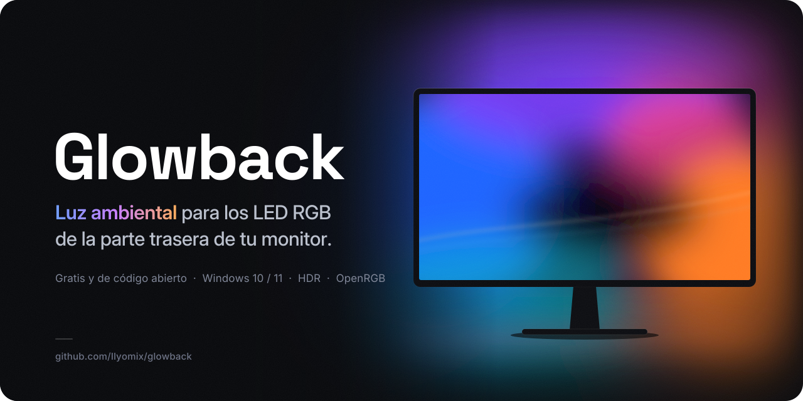

  

  <a href="README.md">English</a> · <a href="README.fr.md">Français</a> · <b>Español</b> · <a href="README.de.md">Deutsch</a> · <a href="README.it.md">Italiano</a> · <a href="README.pt.md">Português</a>

<h1 align="center">Glowback: luz ambiental para monitores con LED RGB traseros</h1>

  <b>Sincronización con la pantalla, gratuita y de código abierto, para los LED RGB de la parte trasera de tu monitor.</b> 
  Cada LED sigue la parte de la imagen que tiene delante, en tiempo real. 
  Compatible con dispositivos de <b>Iluminación dinámica de Windows 11</b> y <b>OpenRGB</b>. Sin tira LED, cámara ni software del fabricante.

  
  
  
  

---

Cada vez más monitores gaming traen LED RGB en la parte trasera, pero su software solo ofrece efectos fijos, de respiración o arcoíris. **Glowback** los convierte en una **auténtica luz ambiental**: captura la pantalla 30 veces por segundo y da **a cada LED su propio color**, tomado del borde de la imagen que tiene delante. Un atardecer a la izquierda de la pantalla tiñe de naranja la pared izquierda.

Glowback no depende de ninguna marca: controla cualquier dispositivo que la **Iluminación dinámica de Windows** (el estándar HID LampArray) u **[OpenRGB](https://openrgb.org)** puedan manejar: monitores, tiras LED, cajas de PC, lámparas.

## ✨ Funciones

- 🎯 **Una zona por LED**, proyectada sobre el borde de pantalla más cercano. También hay un modo de color promedio.
- 🎬 **Películas, juegos y HDR**: captura por GPU (DXGI) en pantalla completa, compatible con HDR, **ignora las bandas negras**.
- 💡 **Colores luminosos y fieles**, incluso en escenas oscuras.
- 🪟 **Una aplicación de Windows de verdad**: instalador, menú Inicio, inicio con Windows, menú oscuro junto al reloj con el estado en directo, desinstalación desde *Configuración → Aplicaciones*.
- 🔄 **Aviso de actualizaciones** una vez al día (desactivable).
- 🌍 **6 idiomas**, según el idioma de Windows.
- 🔌 **Plug and play**: detecta automáticamente los dispositivos de Iluminación dinámica y OpenRGB.
- 🪶 **Ligero**: unos 0,5 ms de CPU por imagen.

## 🚀 Instalación

1. **Conecta el cable USB de subida del monitor** al PC (USB-B o USB-C).
2. **Desactiva la Iluminación dinámica de Windows para ese dispositivo**: *Configuración → Personalización → Iluminación dinámica → tu dispositivo → «Usar Iluminación dinámica en mis dispositivos» → Desactivado*.
3. **Descarga [GlowbackSetup.exe](https://github.com/Ilyomix/glowback/releases/latest/download/GlowbackSetup.exe)** y sigue el asistente (no requiere permisos de administrador).

> Windows SmartScreen puede avisar de un editor desconocido porque la aplicación aún no está firmada: *Más información → Ejecutar de todas formas*. [Política de firma de código](CODE_SIGNING.md) · [Privacidad](PRIVACY.md)

Para comprobar la orientación de los LED: *menú Inicio → Herramientas de Glowback → Probar los LED* (izquierda roja, derecha azul).

## ✅ ¿Funciona con mi monitor?

Sí, si se cumple **una** de estas condiciones:

1. **Aparece en Windows** en *Configuración → Personalización → Iluminación dinámica*.
2. **Es compatible con [OpenRGB](https://openrgb.org)**: inicia OpenRGB con su servidor SDK y Glowback lo detecta solo.
3. **¿Ninguna de las dos?** Añade una tira LED con una placa RP2040 de 5 $: [guía DIY](docs/DIY-LED-strip.md) (en inglés).

Probado con: AOC AGON PRO AG276QZD2 (47 LED). ¿Funciona en tu monitor? [Cuéntanoslo](https://github.com/Ilyomix/glowback/issues/new?template=device-report.yml).

## 🪟 Menú del icono

Clic derecho en el icono de Glowback junto al reloj: **estado** (activo y número de LED, en pausa, buscando LED), **Luz ambiental** (pausa/reanudar), **Iniciar con Windows**, **Buscar actualizaciones**, **Modo**, **Brillo**, **Creado por Ilyomix**, **Dar una estrella en GitHub**, **Abrir registro**, **Salir**.

## 🗑️ Desinstalar

- **Instalador**: *Configuración → Aplicaciones → Aplicaciones instaladas → Glowback → Desinstalar*. Los LED vuelven al efecto del dispositivo.
- **Versión Python**: `glowback --uninstall` y después `pip uninstall glowback`.
- **Portable**: `glowback.exe --uninstall` y borra los .exe.

## ❓ Preguntas frecuentes

**¿Qué monitores son compatibles?** Cualquiera cuya iluminación RGB trasera pueda controlarse mediante la Iluminación dinámica de Windows u OpenRGB. Compruébalo con `glowback --list`.

**¿Funciona con HDR, juegos y películas en pantalla completa?** Sí. Los contenidos protegidos con DRM suelen aparecer en negro para cualquier herramienta de captura.

**No se enciende nada.** Comprueba el cable USB del monitor, que el RGB esté activado en el menú del monitor y que la Iluminación dinámica de Windows esté desactivada para ese dispositivo.

**Los colores están del lado equivocado.** Usa *Probar los LED*; si izquierda y derecha están invertidas, añade `--mirror`.

Opciones de línea de comandos y detalles técnicos: [README en inglés](README.md#%EF%B8%8F-command-line).

## ⭐ Apoyo

Si Glowback ilumina tu escritorio, **dale una estrella al repositorio**: así lo encuentran otros dueños de monitores RGB.

---

Ambilight es una marca de Koninklijke Philips N.V. / TP Vision. Glowback es un proyecto de código abierto independiente, sin relación con ellos.

MIT © [Ilyomix](https://github.com/Ilyomix) · [Política de firma de código](CODE_SIGNING.md) · [Privacidad](PRIVACY.md)
