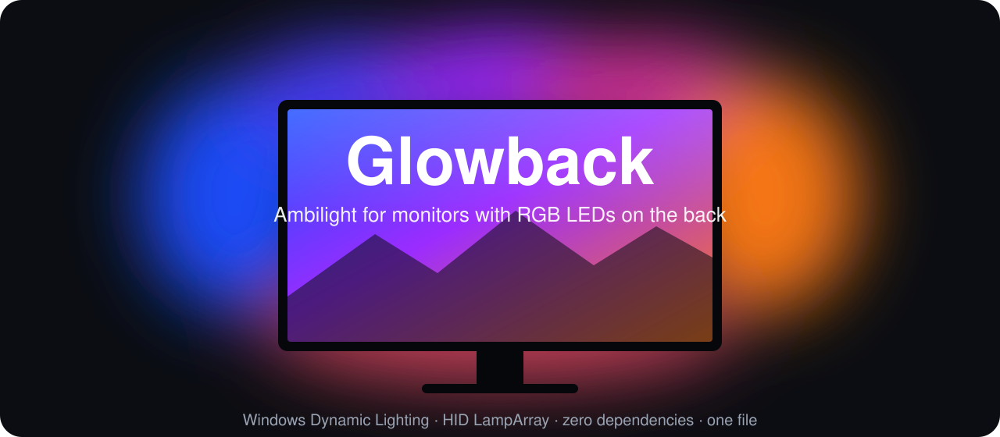

<p align="center">
  
</p>

<h1 align="center">Glowback : l'Ambilight pour les LED RGB à l'arrière de votre écran PC</h1>

<p align="center">
  <b>Votre écran a déjà des LED RGB au dos. Glowback fait suivre à chaque LED la partie de l'image juste devant elle, en temps réel.</b><br>
  Éclairage d'ambiance synchronisé à l'écran pour Windows. Sans caméra, sans ruban LED à acheter, sans logiciel constructeur, sans dépendance.
</p>

<p align="center">
  <a href="https://github.com/Ilyomix/glowback/releases/latest"></a>
  
  
  
  <a href="LICENSE"></a>
</p>

<p align="center"><a href="README.md">🇬🇧 English</a></p>

---

Les écrans gaming comme l'**AOC AGON PRO** (Light FX) ont des LED RGB adressables au dos, mais le logiciel fourni se limite à des effets fixes, respiration ou arc-en-ciel. **Glowback** en fait un véritable **éclairage d'ambiance façon Ambilight** : il capture l'écran environ 30 fois par seconde et donne **une couleur propre à chaque LED**, prise sur le bord de l'image le plus proche. Un coucher de soleil à gauche de l'écran, et le mur de gauche devient orange.

Il fonctionne avec **tout appareil compatible « Éclairage dynamique » de Windows 11** (le standard HID LampArray) : écrans, rubans LED, boîtiers PC, lampes.

## ✨ Fonctionnalités

- 🎯 **Une zone par LED** : chaque LED est projetée sur le bord d'écran le plus proche, comme l'Ambilight Philips. Un mode « couleur moyenne » unique existe aussi.
- 🔌 **Plug and play** : détecte tous les appareils Éclairage dynamique / HID LampArray et lit la position physique de chaque LED directement dans l'appareil.
- 🖥️ **Multi-écran** : associe chaque appareil LED à *son* écran en lisant le nom du modèle dans l'EDID (ex. `AG276QZD2`).
- 🪶 **Léger** : un seul fichier Python, **zéro dépendance**, moins de 1 % du CPU total à 30 img/s (mesuré sur un CPU 24 threads).
- 🔁 **Robuste** : survit à l'extinction de l'écran, à la mise en veille, aux reconnexions USB et aux changements de résolution.
- 🎨 **Réglable** : luminosité, saturation, gamma des LED, lissage, taille des zones, fréquence.
- 🧹 **Sortie propre** : à l'arrêt, les LED reprennent l'effet réglé dans le menu de l'écran.
- 🚀 **Démarrage avec Windows** en arrière-plan, en une commande.

## 🚀 Démarrage rapide

1. **Branchez le câble USB montant de l'écran** (USB-B ou USB-C de l'écran vers le PC) : le contrôleur des LED est un périphérique USB.
2. **Désactivez l'Éclairage dynamique de Windows pour cet appareil**, sinon Windows et Glowback se disputent les LED :
   *Paramètres → Personnalisation → Éclairage dynamique → votre écran → « Utiliser l'éclairage dynamique sur mes appareils » → Désactivé*.
3. **Lancez Glowback** avec l'une de ces options :

**Option A : .exe autonome** (sans Python)
Téléchargez `glowback.exe` depuis la [dernière version](https://github.com/Ilyomix/glowback/releases/latest) et double-cliquez dessus.

**Option B : avec Python 3.9+**
```bash
pipx install git+https://github.com/Ilyomix/glowback
```
```bash
glowback
```

**Option C : fichier unique**
```bash
curl -LO https://raw.githubusercontent.com/Ilyomix/glowback/main/glowback.py
```
```bash
python glowback.py
```

Ensuite :

```bash
glowback --test             # vérifier l'orientation : gauche rouge, droite bleu
glowback --autostart on     # lancer avec Windows, en arrière-plan
glowback --stop             # arrêter l'instance en arrière-plan
```

## ✅ Appareils compatibles

Glowback pilote les appareils **HID LampArray**, le standard ouvert derrière l'*Éclairage dynamique* de Windows 11. Si votre appareil apparaît dans *Paramètres → Personnalisation → Éclairage dynamique*, il devrait fonctionner. Vérifiez avec `glowback --list`.

| Appareil | LED | Statut |
|---|---|---|
| **AOC AGON PRO AG276QZD2** (Light FX, `05F6:AC37`) | 47 | ✅ Testé |
| Autres écrans AOC AGON avec Light FX compatible Éclairage dynamique | n/a | 🟡 Devrait marcher. [Signalez-le](https://github.com/Ilyomix/glowback/issues/new?template=device-report.yml) |
| Tout écran, ruban LED, boîtier ou lampe listé dans l'*Éclairage dynamique* de Windows | n/a | 🟡 Devrait marcher. [Signalez-le](https://github.com/Ilyomix/glowback/issues/new?template=device-report.yml) |
| Claviers et souris compatibles Éclairage dynamique | n/a | 🟡 Sur demande avec `--device all` |

**Ça marche sur un autre écran ?** Ouvrez un [rapport d'appareil](https://github.com/Ilyomix/glowback/issues/new?template=device-report.yml) avec la sortie de `glowback --list` et une courte vidéo : chaque rapport ajoute une ligne à ce tableau.

## ⚙️ Options

| Option | Défaut | Description |
|---|---|---|
| `--mode zones\|average` | `zones` | `zones` : chaque LED suit sa partie de l'image. `average` : une seule couleur moyenne |
| `--brightness 0-100` | `100` | Luminosité des LED |
| `--saturation` | `1.3` | Renforcement des couleurs (`1` = couleurs fidèles) |
| `--gamma` | `1.6` | Gamma des LED. Plus haut, les sombres sont plus profonds ; plus bas, les tons moyens sont plus lumineux |
| `--smoothing` | `0.1` | Durée des transitions en secondes. Plus haut = plus calme, `0` = instantané |
| `--radius` | `0.12` | Taille de la zone de chaque LED, en fraction de la hauteur d'écran |
| `--blend 0-1` | `0` | Mélange la moyenne de tout l'écran dans chaque zone, pour une lueur plus uniforme |
| `--fps` | `30` | Mises à jour par seconde (plafonné par l'appareil, ex. 50 Hz pour l'AOC Light FX) |
| `--screen` | `auto` | `auto` (correspondance EDID, sinon écran principal), `primary`, un numéro de `--list` ou un nom |
| `--device` | appareils d'ambiance | Partie du nom ou `VID:PID`, ou `all` pour inclure claviers et souris |
| `--mirror` / `--flip` | non | Inverse gauche/droite ou haut/bas si `--test` les montre à l'envers |
| `--list` · `--test` · `--stop` | | Lister appareils et écrans · motif de test · arrêter l'instance en arrière-plan |
| `--autostart on\|off` | | Lancement à l'ouverture de session, avec les autres options passées |
| `-v` | | Affiche les images par seconde |

Exemple, lueur plus douce pour les films :

```bash
glowback --brightness 70 --smoothing 0.35 --blend 0.2
```

## 🔬 Fonctionnement

1. **Détection** : Glowback cherche les interfaces HID de page d'usage `0x59` (*Lighting and Illumination*), usage `LampArray`. Les ID de rapport et la disposition des octets sont **lus dans le descripteur HID** via `HidP_*` : aucun code spécifique à un appareil.
2. **Géométrie** : chaque LED indique sa position X/Y/Z en micromètres. Glowback les normalise et projette chaque LED depuis le centre vers le bord de l'écran, comme une TV Ambilight associe ses LED à l'image.
3. **Capture** : un `StretchBlt` échantillonné de l'écran suivi d'une réduction `HALFTONE` donne une petite grille de couleurs moyennées. Chaque LED prend une moyenne pondérée (gaussienne) des cellules autour de son point de bord.
4. **Sortie** : couleurs lissées dans le temps, corrigées en gamma, envoyées par `LampMultiUpdateReport` (8 LED par rapport, le dernier marqué `LampUpdateComplete`) après avoir quitté l'`AutonomousMode`, rétabli à la sortie.

Tout le programme tient dans un fichier lisible : [`glowback.py`](glowback.py).

## ❓ FAQ

**Faut-il une caméra ou un ruban LED en plus ?**
Non. Glowback utilise les LED RGB déjà intégrées au dos de l'écran.

**Rien ne s'allume.**
Vérifiez que le câble USB montant de l'écran est branché au PC, que Light FX / RGB est activé dans le menu de l'écran, et que l'Éclairage dynamique de Windows est désactivé pour cet appareil. `glowback --list` montre ce que voit Glowback.

**Les couleurs sont du mauvais côté.**
Lancez `glowback --test`. Si gauche et droite sont inversés, ajoutez `--mirror` ; si haut et bas sont inversés, ajoutez `--flip`.

**Ça marche dans les jeux et les vidéos ?**
Oui en jeu fenêtré ou plein écran fenêtré (borderless), et dans tous les lecteurs vidéo. Certains jeux en plein écran *exclusif* ne sont pas capturables via GDI et donnent du noir : passez en borderless. (La capture DXGI est prévue.)

**HDR ?**
Ça fonctionne, mais la capture est convertie en SDR, donc les couleurs peuvent paraître un peu plus ternes.

**Lien avec Philips Ambilight, Hyperion ou Prismatik ?**
Aucun. Glowback est un projet indépendant inspiré de la même idée. Contrairement à Hyperion et Prismatik, il n'a besoin ni de ruban LED ni de microcontrôleur si votre écran a déjà des LED au dos.

## ⭐ Soutien

Si Glowback a illuminé votre bureau, **mettez une étoile au dépôt** : ça aide les autres propriétaires d'écrans RGB à le trouver.

---

<sub>Mots-clés : ambilight PC, ambilight écran PC, ambilight Windows, synchronisation RGB écran, éclairage d'ambiance écran, bias lighting, AOC AGON Light FX synchronisation écran, AGON PRO ambilight, Éclairage dynamique Windows 11, HID LampArray, LED arrière écran gaming, alternative Hyperion, alternative Prismatik.</sub>

<sub>Ambilight est une marque de Koninklijke Philips N.V. / TP Vision. AOC et AGON sont des marques de leurs propriétaires respectifs. Glowback est un projet open source indépendant, sans lien ni approbation de leur part.</sub>

MIT © Ilyomix
