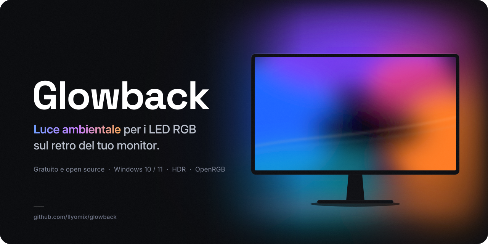

  

  <a href="README.md">English</a> · <a href="README.fr.md">Français</a> · <a href="README.es.md">Español</a> · <a href="README.de.md">Deutsch</a> · <b>Italiano</b> · <a href="README.pt.md">Português</a>

<h1 align="center">Glowback: luce ambientale per monitor con LED RGB sul retro</h1>

  <b>Sincronizzazione con lo schermo, gratuita e open source, per i LED RGB sul retro del tuo monitor.</b> 
  Ogni LED segue la parte dell'immagine davanti a sé, in tempo reale. 
  Compatibile con i dispositivi <b>Illuminazione dinamica di Windows 11</b> e <b>OpenRGB</b>. Niente strisce LED, fotocamere o software del produttore.

  
  
  
  

---

Sempre più monitor da gaming hanno LED RGB sul retro, ma il loro software offre solo effetti fissi, a respiro o arcobaleno. **Glowback** li trasforma in una **vera luce ambientale**: cattura lo schermo 30 volte al secondo e dà **a ogni LED il suo colore**, preso dal bordo dell'immagine proprio davanti a lui. Un tramonto a sinistra dello schermo colora d'arancione la parete di sinistra.

Glowback non è legato a nessuna marca: controlla qualsiasi dispositivo gestibile dall'**Illuminazione dinamica di Windows** (lo standard HID LampArray) o da **[OpenRGB](https://openrgb.org)**: monitor, strisce LED, case per PC, lampade.

## ✨ Funzionalità

- 🎯 **Una zona per LED**, proiettata sul bordo dello schermo più vicino. In alternativa, un solo colore medio.
- 🎬 **Film, giochi, HDR**: cattura tramite GPU (DXGI) a schermo intero, compatibile con l'HDR, **ignora le bande nere**.
- 💡 **Colori luminosi e fedeli**, anche nelle scene scure.
- 🪟 **Una vera app per Windows**: una finestra con un'anteprima in diretta dei tuoi LED, impostazioni rapide dall'icona accanto all'orologio, installer, menu Start, avvio con Windows e disinstallazione pulita da *Impostazioni → App*.
- 🎨 **Colori, sfumature e musica**: oltre allo schermo, un colore, una sfumatura (ferma o in movimento), o LED che seguono il suono del PC: pulsazione, spettro o onde.
- 🌙 **Profili**: una luce più morbida di notte, agli orari che scegli, e un'atmosfera per ogni app: la musica mentre suona Spotify, lo schermo per i giochi, il blu nell'editor di codice.
- 🔄 **Avviso di aggiornamenti** una volta al giorno (disattivabile).
- 📱 **Apple Casa, Google Home e Alexa, senza Home Assistant**: con Matter, Glowback è una luce nell'app Casa del telefono. Pagina *Apple e Google* di Glowback; guida nel [README in inglese](README.md#-apple-home-google-home-and-alexa).
- 🏠 **Home Assistant, Google Assistant, Alexa e Siri**: Glowback compare come una luce da comandare da dashboard, automazioni o con la voce.
- 🌍 **6 lingue**, in base alla lingua di Windows.
- 🔌 **Plug and play**: rileva automaticamente i dispositivi Illuminazione dinamica e OpenRGB.
- 🪶 **Leggero**: circa 0,5 ms di CPU per immagine.

## 🚀 Installazione

1. **Collega il cavo USB upstream del monitor** al PC (USB-B o USB-C).
2. **Disattiva l'Illuminazione dinamica di Windows per quel dispositivo**: *Impostazioni → Personalizzazione → Illuminazione dinamica → il tuo dispositivo → «Usa Illuminazione dinamica nei miei dispositivi» → Disattivato*.
3. **Scarica [GlowbackSetup.exe](https://github.com/Ilyomix/glowback/releases/latest/download/GlowbackSetup.exe)** e segui la procedura guidata (non servono diritti di amministratore).

> Windows SmartScreen potrebbe segnalare un autore sconosciuto perché l'app non è ancora firmata: *Ulteriori informazioni → Esegui comunque*. [Politica di firma del codice](CODE_SIGNING.md) · [Privacy](PRIVACY.md)

Per verificare l'orientamento dei LED: *menu Start → Strumenti di Glowback → Prova i LED* (sinistra rossa, destra blu).

## ✅ Il mio monitor è compatibile?

Sì, se vale **una** di queste condizioni:

1. **Compare in Windows** in *Impostazioni → Personalizzazione → Illuminazione dinamica*.
2. **È supportato da [OpenRGB](https://openrgb.org)**: avvia OpenRGB con il suo server SDK e Glowback lo rileva da solo.
3. **Nessuna delle due?** Aggiungi una striscia LED con una scheda RP2040 da 5 $: [guida DIY](docs/DIY-LED-strip.md) (in inglese).

Testato con: AOC AGON PRO AG276QZD2 (47 LED). Funziona sul tuo monitor? [Faccelo sapere](https://github.com/Ilyomix/glowback/issues/new?template=device-report.yml).

## 🪟 L'app

Avviando Glowback dal menu Start si apre la sua finestra: **Luce ambientale** (anteprima in diretta dello schermo e dei LED, acceso/spento, atmosfera, luminosità), **Profili**, **Home Assistant**, **Impostazioni** (avvio con Windows, aggiornamenti, lingua) e **Informazioni**. Chiudendola, Glowback continua in background: fai doppio clic sulla sua icona accanto all'orologio per riaprirla, o un clic per il pannello rapido.

## 🎨 Atmosfere e profili

Nella pagina **Luce ambientale** scegli cosa mostrano i LED: lo **schermo** (ogni LED la sua zona, o un colore medio), un **colore**, una **sfumatura** (da 2 a 4 colori, ferma o in movimento) o la **musica**: i LED seguono il suono riprodotto dal PC (pulsazione, spettro o onde), senza microfono e senza registrare nulla. Nella pagina **Profili** l'atmosfera cambia da sola: un **profilo notturno** (orari, luminosità e atmosfera), un'atmosfera **per app** (mentre è aperta, in primo piano, a schermo intero o riproduce suono) e cosa fare **il resto del tempo**. Per esempio: la musica mentre suona Spotify, lo schermo per i giochi a schermo intero. [Guida completa (in inglese)](README.md#-looks).

## 🏠 Home Assistant e Google Assistant

Glowback può comparire in Home Assistant come una luce (acceso/spento, luminosità, colore e modalità), da comandare dalle dashboard, dalle automazioni, da Google Assistant, da Alexa e da Siri (app Casa di Apple, con l'integrazione HomeKit Bridge di Home Assistant). Installa l'app **Mosquitto broker** in Home Assistant, poi nel pannello di Glowback fai clic su **Home Assistant** e inserisci indirizzo, utente e password. [Guida completa (in inglese)](README.md#-home-assistant--google-assistant).

## 🗑️ Disinstallare

- **Installer**: *Impostazioni → App → App installate → Glowback → Disinstalla*. I LED tornano all'effetto del dispositivo.
- **Versione Python**: `glowback --uninstall`, poi `pip uninstall glowback`.
- **Portatile**: `glowback.exe --uninstall`, poi elimina i file .exe.

## ❓ Domande frequenti

**Quali monitor sono compatibili?** Qualsiasi monitor la cui illuminazione RGB posteriore sia controllabile tramite l'Illuminazione dinamica di Windows o OpenRGB. Verifica con `glowback --list`.

**Funziona con HDR, giochi e film a schermo intero?** Sì. I contenuti protetti da DRM di solito risultano neri per qualsiasi strumento di cattura.

**Non si accende nulla.** Controlla il cavo USB del monitor, che l'RGB sia attivo nel menu del monitor e che l'Illuminazione dinamica di Windows sia disattivata per quel dispositivo.

**I colori sono dal lato sbagliato.** Usa *Prova i LED*; se sinistra e destra sono invertite, aggiungi `--mirror`.

Opzioni da riga di comando e dettagli tecnici: [README in inglese](README.md#%EF%B8%8F-command-line).

## ⭐ Supporto

Se Glowback illumina la tua scrivania, **metti una stella al repository**: così lo trovano altri possessori di monitor RGB.

---

Ambilight è un marchio di Koninklijke Philips N.V. / TP Vision. Glowback è un progetto open source indipendente, senza legami con loro.

MIT © [Ilyomix](https://github.com/Ilyomix) · [Politica di firma del codice](CODE_SIGNING.md) · [Privacy](PRIVACY.md)
