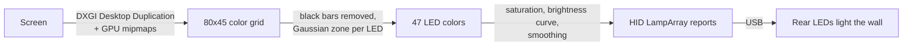

<p align="center">
  
</p>

<h1 align="center">Glowback: Ambilight for PC monitors with rear RGB LEDs</h1>

<p align="center">
  <b>Free, open-source screen sync for the RGB LEDs on the back of your monitor.</b><br>
  Each LED follows the part of the picture it sits behind, in real time, like a Philips Ambilight TV.<br>
  No LED strip, no camera, no vendor app. Works with any <b>Windows 11 Dynamic Lighting</b> device.
</p>

<p align="center">
  <a href="https://github.com/Ilyomix/glowback/releases/latest"></a>
  
  
  
  <a href="LICENSE"></a>
  <a href="https://github.com/Ilyomix/glowback/stargazers"></a>
</p>

<p align="center">
  <a href="#-quick-start">Quick start</a> ·
  <a href="#-compatible-monitors-and-devices">Compatible devices</a> ·
  <a href="#-tray-icon-and-windows-integration">Windows integration</a> ·
  <a href="#-uninstall">Uninstall</a> ·
  <a href="#-faq">FAQ</a> ·
  <a href="https://ilyomix.github.io/glowback/">Website</a> ·
  <a href="README.fr.md">🇫🇷 Français</a>
</p>

---

Gaming monitors like the **AOC AGON PRO** (Light FX) ship with addressable RGB LEDs on the back. The bundled software only offers static, breathing or rainbow effects. **Glowback** turns those LEDs into **Ambilight-style bias lighting**: it captures your screen 30 times per second and gives **each LED its own color**, taken from the edge of the image right in front of it. A sunset on the left of the screen turns the wall on the left orange, and an explosion on the right lights the right side.

It drives **HID LampArray** devices, the open standard behind **Windows 11 Dynamic Lighting**. That covers monitors with rear RGB, and also LED strips, PC cases and lamps that support it.

## ✨ Features

- 🎯 **One zone per LED**: each LED is projected onto the nearest screen edge, the way an Ambilight TV maps its LEDs. A single "average color" mode is also available.
- 🎬 **Fullscreen video and games**: GPU capture (DXGI Desktop Duplication) sees fullscreen players and games, **including HDR**. **Black bars are ignored** on movies (letterbox and pillarbox detection).
- 💡 **Bright, true colors**: a hue-preserving brightness curve keeps the glow visible on dark scenes, and saturation is tunable.
- 🪟 **Native Windows integration**: an icon in the notification area to pause, change mode or brightness. Optional start with Windows, a Start menu entry, and a one-command uninstall.
- 🔌 **Plug and play**: finds every Dynamic Lighting device and reads each LED's physical position from the device itself.
- 🖥️ **Multi-monitor aware**: matches each LED device to its own screen by reading the monitor's EDID model name.
- 🪶 **Lightweight**: about 0.5 ms of CPU per frame, a single Python file, **zero dependencies**.
- 🔁 **Robust**: survives monitor power cycles, sleep, USB reconnects, resolution and HDR changes.
- 🌈 **Beyond monitors**: [OpenRGB](https://openrgb.org) devices (`--openrgb`), a [DIY LED strip with a $5 RP2040](docs/DIY-LED-strip.md), and per-device white balance (`--calibrate`).

## 🚀 Quick start

1. **Plug in the monitor's USB upstream cable** (USB-B or USB-C from the monitor to the PC). The LED controller is a USB device.
2. **Turn off Windows Dynamic Lighting for that device**, otherwise Windows and Glowback fight over the LEDs:
   *Settings → Personalization → Dynamic Lighting → your monitor → "Use Dynamic Lighting on my devices" → Off*.
3. **Install Glowback** using one of these options:

**Option A: Windows app, no Python needed**
Download [`GlowbackTray.exe`](https://github.com/Ilyomix/glowback/releases/latest/download/GlowbackTray.exe) and double-click it. The icon appears next to the clock. For the command line version, use [`glowback.exe`](https://github.com/Ilyomix/glowback/releases/latest/download/glowback.exe) and type `.\glowback.exe` instead of `glowback` in the commands below.

**Option B: with Python 3.9+** (installs the `glowback` command)
```bash
pip install git+https://github.com/Ilyomix/glowback
```
```bash
glowback --install
```

**Option C: single file**
```bash
curl -LO https://raw.githubusercontent.com/Ilyomix/glowback/main/glowback.py
```
```bash
python glowback.py
```
(then type `python glowback.py` instead of `glowback` in the commands below)

`glowback --install` makes Glowback start with Windows in the background and adds it to the Start menu. Then check the orientation once:

```bash
glowback --test
```

Left must be red and right blue. If they are swapped, add `--mirror`.

## 🪟 Tray icon and Windows integration

Glowback lives in the notification area, next to the clock. Right-click (or left-click) its icon to:

| Menu item | What it does |
|---|---|
| **Ambilight enabled** | Pause or resume. When paused, the LEDs go back to the effect set in the monitor's menu |
| **Each LED follows its zone / One average color** | Switch mode instantly |
| **Brightness** | 100 / 75 / 50 / 25 % |
| **Start with Windows** | Turn automatic startup on or off |
| **Open log / Help and updates** | Troubleshooting and this page |
| **Quit** | Stop Glowback and hand the LEDs back to the monitor |

Settings changed from the tray are remembered. Run `glowback --no-tray` if you prefer no icon.

## ✅ Compatible monitors and devices

Glowback works with **HID LampArray** devices. If your device appears under *Settings → Personalization → Dynamic Lighting*, it should work. Run `glowback --list` to check.

| Device | LEDs | Status |
|---|---|---|
| **AOC AGON PRO AG276QZD2** (Light FX, `05F6:AC37`) | 47 | ✅ Tested |
| Other AOC AGON monitors with Dynamic Lighting Light FX | n/a | 🟡 Should work. [Report it](https://github.com/Ilyomix/glowback/issues/new?template=device-report.yml) |
| Any monitor, LED strip, case or lamp listed in Windows *Dynamic Lighting* | n/a | 🟡 Should work. [Report it](https://github.com/Ilyomix/glowback/issues/new?template=device-report.yml) |
| Keyboards and mice with Dynamic Lighting | n/a | 🟡 Opt-in with `--device all` |
| **Any RGB device supported by [OpenRGB](https://openrgb.org)** (ARGB strips, motherboards, cases, WLED…) | n/a | 🟡 With `--openrgb` (see below) |
| **Any monitor + a $5 RP2040 board and an LED strip** | n/a | 🛠️ [DIY guide](docs/DIY-LED-strip.md) |

**Got it working on another monitor?** Open a [device report](https://github.com/Ilyomix/glowback/issues/new?template=device-report.yml) with your `glowback --list` output and a short video. Every report adds a line to this table.

## 🌈 OpenRGB, LED strips and DIY

- **OpenRGB**: start [OpenRGB](https://openrgb.org)'s SDK server, then run `glowback --openrgb`. LED strips are assumed to run around the screen from `--strip-start` (default `bottom-left`, clockwise; add `--strip-ccw` to reverse). Matrix devices use their own layout. Glowback switches them to direct mode and restores your OpenRGB effect on exit.
- **No RGB on your monitor?** Build one: [DIY guide with a $5 RP2040 board](docs/DIY-LED-strip.md). `glowback --diy-layout` generates the LED positions for the firmware.
- **White balance**: LEDs and wall paint are rarely neutral. Run `glowback --calibrate` and adjust with the keyboard until the wall looks white. This is saved per device.

## 🆚 Glowback compared to other ambient lighting options

| | Glowback | Ambilight TV | LED strip kits with sync box or camera | DIY (Hyperion, Prismatik + Arduino) |
|---|---|---|---|---|
| Uses the LEDs already on your monitor | ✅ | n/a | ❌ | ❌ |
| Extra hardware to buy | None | A TV | Strip, box or camera | Strip and microcontroller |
| Per-LED screen sync | ✅ | ✅ | ✅ | ✅ |
| Open source | ✅ MIT | ❌ | ❌ | ✅ |
| Setup time | 1 minute | n/a | 30+ minutes | Hours |

## ⚙️ Options

| Option | Default | Description |
|---|---|---|
| `--mode zones\|average` | `zones` | `zones`: each LED follows its own part of the image. `average`: one color for all LEDs |
| `--brightness 0-100` | `100` | LED brightness |
| `--boost` | `1.8` | Lifts dim colors without changing their hue (`1` = off). Raise it if the glow is too faint |
| `--saturation` | `1.25` | Color boost (`1` = true colors) |
| `--gamma` | `1.0` | Per-channel gamma. Above 1 gives deeper darks |
| `--smoothing` | `0.1` | Transition time in seconds. Higher is calmer, `0` is instant |
| `--radius` | `0.12` | Size of each LED's zone, as a fraction of screen height |
| `--blend 0-1` | `0` | Mixes the whole-screen average into each zone for a calmer glow |
| `--letterbox on\|off` | `on` | Ignore black bars on movies |
| `--capture auto\|dxgi\|gdi` | `auto` | GPU capture (DXGI) with GDI fallback |
| `--fps` | `30` | Updates per second (devices cap this, e.g. 50 Hz for AOC Light FX) |
| `--screen` | `auto` | `auto` (EDID match, then primary screen), `primary`, a number from `--list`, or a name |
| `--device` | ambient devices | Part of a device name or `VID:PID`, or `all` to include keyboards and mice |
| `--mirror` / `--flip` | off | Swap left/right or top/bottom if `--test` shows them reversed |
| `--openrgb [HOST:PORT]` | off | Also drive OpenRGB devices (default `127.0.0.1:6742`) |
| `--strip-start` / `--strip-ccw` | `bottom-left` | Where OpenRGB LED strips begin, and their direction |
| `--calibrate` · `--white-balance R,G,B` | | Per-device white balance (interactive) · or fixed multipliers |
| `--diy-layout WxH:L,T,R,B` | | Print LED positions for the [DIY RP2040 firmware](docs/DIY-LED-strip.md) |
| `--install` / `--uninstall` | | Add to or remove from Windows (startup and Start menu) |
| `--autostart on\|off` | | Only turn automatic startup on or off |
| `--list` · `--test` · `--stop` | | List devices and screens · test pattern · stop the running instance |
| `--no-tray` · `-v` | | No notification icon · print frames per second |

Example for a calmer, film-friendly glow:

```bash
glowback --install --brightness 70 --smoothing 0.35 --blend 0.2
```

## 🗑️ Uninstall

**1. Remove Glowback from Windows** (stops it, removes it from startup and the Start menu, and deletes its settings and logs):

```bash
glowback --uninstall
```

With the `.exe`, run `.\glowback.exe --uninstall` from its folder.

**2. Remove the program:**
- installed with pip: `pip uninstall glowback`
- `.exe`: delete `glowback.exe` / `GlowbackTray.exe`
- single file: delete `glowback.py`

The LEDs automatically return to the effect set in the monitor's on-screen menu.

**Just want to turn it off for a while?** Right-click the tray icon and uncheck *Ambilight enabled*. To stop it from starting with Windows, uncheck *Start with Windows*. You can also disable "Glowback" in *Task Manager → Startup apps*.

## 🔬 How it works



1. **Device discovery**: Glowback looks for HID interfaces with usage page `0x59` (*Lighting and Illumination*), usage `LampArray`. The report IDs and byte layout are **read from the HID descriptor** through `HidP_*`, so no device-specific code is needed.
2. **LED geometry**: each lamp reports its X/Y/Z position in micrometers. Glowback normalizes them and projects each LED outward from the center onto the screen border, the same way an Ambilight TV maps its LEDs to the picture.
3. **Capture**: DXGI Desktop Duplication hands over each new frame on the GPU. `GenerateMips` averages it down to about 80×45 pixels, and only that tiny image is read back. HDR (FP16 scRGB) frames are converted using your *SDR content brightness* setting. GDI is the fallback.
4. **Output**: colors are smoothed over time and sent in `LampMultiUpdateReport`s (8 LEDs per report, the last one flagged `LampUpdateComplete`) after switching the device out of `AutonomousMode`. On exit, `AutonomousMode` is restored.

The whole program is one readable file: [`glowback.py`](glowback.py).

## ❓ FAQ

### How do I sync my monitor's RGB lighting with what's on screen?
Install Glowback, turn off Windows Dynamic Lighting for the monitor, and run `glowback --install`. From then on, the rear LEDs follow the picture automatically.

### Does AOC AGON Light FX support screen sync or Ambilight?
Not with AOC's own software, which only has preset effects. The Light FX controller of the AG276QZD2 (and likely other recent AGON models) supports the Windows Dynamic Lighting standard, which Glowback uses to sync each of its LEDs with the screen.

### Can I get Ambilight on a PC monitor without an LED strip?
Yes, if the monitor has RGB LEDs on the back that support Windows Dynamic Lighting. Glowback uses those LEDs directly.

### Does it work with HDR, fullscreen games and movies?
Yes. DXGI capture handles fullscreen and borderless games, video players and HDR desktops, and black bars are ignored. DRM-protected streams (for example some Netflix playback in browsers) are usually blacked out by Windows for every capture tool, so the LEDs stay dark there.

### Does it slow down my games?
It is built not to: the GPU does the downscaling and Glowback uses about 0.5 ms of CPU per frame at 30 fps (measured on the author's PC).

### The glow is too faint.
Raise `--boost` (for example `2.5`), check the Light FX brightness in the monitor's menu, and make sure Windows Dynamic Lighting is off for the device.

### Nothing lights up.
Check that the monitor's USB upstream cable is connected to the PC, that Light FX / RGB is enabled in the monitor's menu, and that Windows Dynamic Lighting is off for that device. `glowback --list` shows what Glowback sees, and the log is in `%LOCALAPPDATA%\Glowback`.

### The colors are on the wrong side.
Run `glowback --test`. If left and right are swapped, add `--mirror`. If top and bottom are swapped, add `--flip`.

### Is this related to Philips Ambilight, Hyperion or Prismatik?
No. Glowback is an independent project inspired by the same idea. It needs no LED strip or microcontroller when your monitor already has rear LEDs.

## 🗺️ Roadmap

- [x] System tray icon with quick settings, start with Windows, Start menu, uninstall
- [x] DXGI Desktop Duplication capture (lower CPU, fullscreen games and video, HDR)
- [x] Letterbox (black bars) detection for movies
- [x] OpenRGB SDK output, for monitors and LED strips that are not LampArray
- [x] [DIY guide](docs/DIY-LED-strip.md): turn any LED strip into a LampArray with a $5 RP2040 board
- [x] Per-device white balance calibration
- [ ] Rotated (portrait) screens in DXGI capture (GDI fallback today)
- [ ] Prebuilt RP2040 firmware (.uf2) for common strip lengths

Contributions are welcome. See [CONTRIBUTING.md](CONTRIBUTING.md).

## ⭐ Support

If Glowback lit up your desk, **star the repo**. It helps other owners of RGB monitors find it.

---

<sub>Keywords: ambilight PC, ambilight for monitor, ambilight Windows 11, monitor screen sync RGB, screen ambient lighting, bias lighting PC, AOC AGON Light FX screen sync, AGON PRO AG276QZD2 RGB, Windows Dynamic Lighting ambilight, HID LampArray, rear RGB monitor, gaming monitor RGB sync, immersive lighting, HDR ambilight, free Hyperion alternative, Prismatik alternative, SignalRGB screen ambience alternative.</sub>

<sub>Ambilight is a trademark of Koninklijke Philips N.V. / TP Vision. AOC and AGON are trademarks of their respective owners. Glowback is an independent open-source project and is not affiliated with or endorsed by them.</sub>

MIT © Ilyomix
