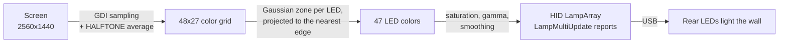

<p align="center">
  
</p>

<h1 align="center">Glowback: Ambilight for your PC monitor's rear RGB LEDs</h1>

<p align="center">
  <b>Your monitor already has RGB LEDs on the back. Glowback makes each LED follow the part of the picture it sits behind, in real time.</b><br>
  Screen-synced bias lighting for Windows. No camera, no LED strip to buy, no vendor app, no dependencies.
</p>

<p align="center">
  <a href="https://github.com/Ilyomix/glowback/releases/latest"></a>
  
  
  
  <a href="LICENSE"></a>
  <a href="https://github.com/Ilyomix/glowback/stargazers"></a>
</p>

<p align="center">
  <a href="#-quick-start">Quick start</a> ·
  <a href="#-compatible-devices">Compatible devices</a> ·
  <a href="#%EF%B8%8F-options">Options</a> ·
  <a href="#-how-it-works">How it works</a> ·
  <a href="#-faq">FAQ</a> ·
  <a href="README.fr.md">🇫🇷 Français</a>
</p>

---

Gaming monitors such as the **AOC AGON PRO** (Light FX) ship with addressable RGB LEDs on the back, but the bundled software only offers static, breathing or rainbow effects. **Glowback** turns those LEDs into a real **Ambilight-style ambient light**: it captures the screen about 30 times per second and gives **every single LED its own color**, taken from the edge of the image closest to it. When a sunset sits on the left of the screen, the wall on the left turns orange.

It works with **any device that supports Windows 11 Dynamic Lighting** (the HID LampArray standard): monitors, LED strips, PC cases and lamps.

## ✨ Features

- 🎯 **One zone per LED**: each LED is projected onto the nearest screen edge, like Philips Ambilight. A single "average color" mode is also available.
- 🔌 **Plug and play**: finds every Dynamic Lighting / HID LampArray device and reads each LED's physical position from the device itself.
- 🖥️ **Multi-monitor aware**: matches each LED device to *its own* screen by reading the monitor's EDID model name (e.g. `AG276QZD2`).
- 🪶 **Lightweight**: one Python file, **zero dependencies**, under 1 % total CPU at 30 fps (measured on a 24-thread CPU).
- 🔁 **Hot-plug safe**: survives monitor power cycles, sleep, USB reconnects and resolution changes.
- 🎨 **Tunable**: brightness, saturation boost, LED gamma, smoothing, zone size, frame rate.
- 🧹 **Clean exit**: on stop, the LEDs go back to the effect you set in the monitor's menu.
- 🚀 **Starts with Windows** in the background with a single command.

## 🚀 Quick start

1. **Plug in the monitor's USB upstream cable** (USB-B or USB-C from the monitor to the PC). The LED controller is a USB device.
2. **Turn off Windows Dynamic Lighting for that device**, otherwise Windows and Glowback fight over the LEDs:
   *Settings → Personalization → Dynamic Lighting → your monitor → "Use Dynamic Lighting on my devices" → Off*.
3. **Run Glowback** using one of these:

**Option A: standalone .exe** (no Python needed)
Download `glowback.exe` from the [latest release](https://github.com/Ilyomix/glowback/releases/latest) and double-click it.

**Option B: with Python 3.9+**
```bash
pipx install git+https://github.com/Ilyomix/glowback
```
```bash
glowback
```

**Option C: single file**
```bash
curl -LO https://raw.githubusercontent.com/Ilyomix/glowback/main/glowback.py
```
```bash
python glowback.py
```

Then:

```bash
glowback --test             # check orientation: left must be red, right blue
glowback --autostart on     # start with Windows, in the background
glowback --stop             # stop the background instance
```

## ✅ Compatible devices

Glowback drives **HID LampArray** devices, the open standard behind Windows 11 *Dynamic Lighting*. If your device appears under *Settings → Personalization → Dynamic Lighting*, it should work. Run `glowback --list` to check.

| Device | LEDs | Status |
|---|---|---|
| **AOC AGON PRO AG276QZD2** (Light FX, `05F6:AC37`) | 47 | ✅ Tested |
| Other AOC AGON monitors with Dynamic Lighting Light FX | n/a | 🟡 Should work. [Report it](https://github.com/Ilyomix/glowback/issues/new?template=device-report.yml) |
| Any monitor, LED strip, case or lamp listed in Windows *Dynamic Lighting* | n/a | 🟡 Should work. [Report it](https://github.com/Ilyomix/glowback/issues/new?template=device-report.yml) |
| Keyboards and mice with Dynamic Lighting | n/a | 🟡 Opt-in with `--device all` |

**Got it working on another monitor?** Open a [device report](https://github.com/Ilyomix/glowback/issues/new?template=device-report.yml) with your `glowback --list` output and a short video. Every report adds a line to this table.

## ⚙️ Options

| Option | Default | Description |
|---|---|---|
| `--mode zones\|average` | `zones` | `zones`: each LED follows its own part of the image. `average`: one color for all LEDs |
| `--brightness 0-100` | `100` | LED brightness |
| `--saturation` | `1.3` | Color boost (`1` = true colors) |
| `--gamma` | `1.6` | LED gamma. Raise it for deeper darks, lower it for brighter mid-tones |
| `--smoothing` | `0.1` | Transition time in seconds. Higher is calmer, `0` is instant |
| `--radius` | `0.12` | Size of each LED's zone, as a fraction of screen height |
| `--blend 0-1` | `0` | Mixes the whole-screen average into each zone for a calmer, more uniform glow |
| `--fps` | `30` | Updates per second (devices cap this, e.g. 50 Hz for AOC Light FX) |
| `--screen` | `auto` | `auto` (EDID match, then primary screen), `primary`, a number from `--list`, or a name |
| `--device` | ambient devices | Part of a device name or `VID:PID`, or `all` to include keyboards and mice |
| `--mirror` / `--flip` | off | Swap left/right or top/bottom if `--test` shows them reversed |
| `--list` · `--test` · `--stop` | | List devices and screens · test pattern · stop the background instance |
| `--autostart on\|off` | | Launch at Windows sign-in, keeping the other options you pass |
| `-v` | | Print frames per second |

Example for a calmer, film-friendly glow:

```bash
glowback --brightness 70 --smoothing 0.35 --blend 0.2
```

## 🔬 How it works



1. **Device discovery**: Glowback looks for HID interfaces with usage page `0x59` (*Lighting and Illumination*), usage `LampArray`. The report IDs and byte layout are **read from the HID descriptor** through `HidP_*`, so no device-specific code is needed.
2. **LED geometry**: each lamp reports its X/Y/Z position in micrometers. Glowback normalizes them and projects each LED outward from the center onto the screen border, the same way an Ambilight TV maps its LEDs to the picture.
3. **Capture**: a cheap sampled `StretchBlt` of the monitor followed by a `HALFTONE` downscale produces a small averaged color grid. Each LED takes a Gaussian-weighted average of the cells around its border point.
4. **Output**: colors are smoothed over time, gamma-corrected for LEDs, and sent in `LampMultiUpdateReport`s (8 LEDs each, the last one flagged `LampUpdateComplete`) after switching the device out of `AutonomousMode`. On exit, `AutonomousMode` is restored.

The whole program is one readable file: [`glowback.py`](glowback.py).

## ❓ FAQ

**Does it need a camera or an extra LED strip?**
No. It uses the RGB LEDs already built into the back of your monitor.

**Nothing lights up.**
Check that the monitor's USB upstream cable is connected to the PC, that Light FX / RGB is enabled in the monitor's on-screen menu, and that Windows Dynamic Lighting is turned off for that device. `glowback --list` shows what Glowback sees.

**The colors are on the wrong side.**
Run `glowback --test`. If left and right are swapped, add `--mirror`. If top and bottom are swapped, add `--flip`.

**Does it work in games and videos?**
Yes in windowed and borderless games and in every video player. Some games in *exclusive* fullscreen cannot be captured through GDI and show black. Use borderless mode. (DXGI capture is on the roadmap.)

**HDR?**
It works, but the capture is SDR-mapped, so colors can look slightly flatter.

**Does it work without Windows 11?**
Glowback talks to the device directly through HID, so it should also run on Windows 10 (not tested yet, reports welcome). The *Dynamic Lighting* settings page only exists on Windows 11.

**Is this related to Philips Ambilight, Hyperion or Prismatik?**
No. Glowback is an independent project inspired by the same idea. Unlike Hyperion and Prismatik, it needs no LED strip or microcontroller when your monitor already has rear LEDs.

## 🗺️ Roadmap

- [ ] System tray icon with quick settings
- [ ] DXGI Desktop Duplication capture (lower CPU, exclusive-fullscreen games)
- [ ] Letterbox (black bars) detection for movies
- [ ] OpenRGB SDK output, for monitors and strips that are not LampArray
- [ ] DIY guide: turn any LED strip into a LampArray with a $5 RP2040 board
- [ ] Per-device white balance calibration

Contributions are welcome. See [CONTRIBUTING.md](CONTRIBUTING.md).

## ⭐ Support

If Glowback lit up your desk, **star the repo**. It helps other owners of RGB monitors find it.

---

<sub>Keywords: ambilight PC, ambilight monitor, ambilight for Windows, screen sync RGB, monitor ambient light, bias lighting, AOC AGON Light FX screen sync, AGON PRO ambilight, Windows 11 Dynamic Lighting ambilight, HID LampArray, rear RGB monitor, gaming monitor RGB sync, immersive lighting, Hyperion alternative, Prismatik alternative.</sub>

<sub>Ambilight is a trademark of Koninklijke Philips N.V. / TP Vision. AOC and AGON are trademarks of their respective owners. Glowback is an independent open-source project and is not affiliated with or endorsed by them.</sub>

MIT © Ilyomix
