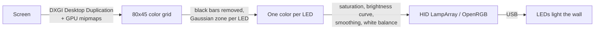

  

  <b>English</b> · <a href="README.fr.md">Français</a> · <a href="README.es.md">Español</a> · <a href="README.de.md">Deutsch</a> · <a href="README.it.md">Italiano</a> · <a href="README.pt.md">Português</a>

<h1 align="center">Glowback: ambient light for monitors with rear RGB LEDs</h1>

  <b>Free, open-source screen sync for the RGB LEDs on the back of your monitor.</b> 
  Each LED follows the part of the picture in front of it, in real time. 
  Works with <b>Windows 11 Dynamic Lighting</b> and <b>OpenRGB</b> devices. No LED strip, camera or vendor app needed.

  
  
  
  
  
  

  <a href="#-install">Install</a> ·
  <a href="#-does-my-monitor-work">Compatibility</a> ·
  <a href="#-tray-menu">Tray menu</a> ·
  <a href="#%EF%B8%8F-uninstall">Uninstall</a> ·
  <a href="#-faq">FAQ</a> ·
  <a href="https://ilyomix.github.io/glowback/">Website</a>

---

More and more gaming monitors ship with RGB LEDs on the back, but their software only offers static, breathing or rainbow effects. **Glowback** turns those LEDs into **real ambient light**: it captures your screen 30 times per second and gives **each LED its own color**, taken from the edge of the picture right in front of it. A sunset on the left of the screen turns the wall on the left orange; an explosion on the right lights the right side.

Glowback is not tied to one brand. It drives any LED device that **Windows Dynamic Lighting** (the HID LampArray standard) or **[OpenRGB](https://openrgb.org)** can control: monitors, LED strips, PC cases, lamps. No compatible LEDs? [Add a $5 DIY strip](docs/DIY-LED-strip.md).

## ✨ Features

- 🎯 **One zone per LED**: each LED is projected onto the nearest screen edge, so the light around your monitor matches the picture. A single "average color" mode is also available.
- 🎬 **Movies, games, HDR**: GPU capture (DXGI) sees fullscreen video and games, handles HDR, and **ignores movie black bars**.
- 💡 **Bright, true colors**: a hue-preserving brightness curve keeps the glow visible in dark scenes.
- 🪟 **A real Windows app**: installer, Start menu, start with Windows, a dark tray menu with live status, and clean uninstall from *Settings → Apps*.
- 🔄 **Update notifications**: Glowback checks GitHub once a day and tells you when a new version is out. One switch turns it off.
- 🌍 **6 languages**: English, French, Spanish, German, Italian and Portuguese, picked from your Windows language.
- 🔌 **Plug and play**: finds Dynamic Lighting devices and OpenRGB automatically, and reads the physical position of every LED.
- 🖥️ **Multi-monitor**: each LED device follows its own screen (matched by the monitor's EDID name).
- 🎨 **White balance** per device, so the wall looks white when the screen is white.
- 🪶 **Lightweight**: about 0.5 ms of CPU per frame. The Python version is a single file with zero dependencies.

## 🚀 Install

1. **Connect the monitor's USB upstream cable** to the PC (USB-B or USB-C). Monitors usually need it so the PC can reach their LEDs.
2. **Turn off Windows Dynamic Lighting for that device**, otherwise Windows and Glowback fight over the LEDs: *Settings → Personalization → Dynamic Lighting → your device → "Use Dynamic Lighting on my devices" → Off*.
3. **Install Glowback:**

| | |
|---|---|
| **Installer (recommended)** | Download [**GlowbackSetup.exe**](https://github.com/Ilyomix/glowback/releases/latest/download/GlowbackSetup.exe) and follow the wizard. No admin rights needed. |
| Portable | [GlowbackTray.exe](https://github.com/Ilyomix/glowback/releases/latest/download/GlowbackTray.exe) (app) and [glowback.exe](https://github.com/Ilyomix/glowback/releases/latest/download/glowback.exe) (command line) |
| Python 3.9+ | `pip install git+https://github.com/Ilyomix/glowback`, then `glowback --install` |

> Windows SmartScreen may warn about an unknown publisher, because the app is not code-signed yet. Click *More info → Run anyway*. The source code and the builds are public on GitHub. [Code signing policy](CODE_SIGNING.md) · [Privacy policy](PRIVACY.md)

Glowback then sits next to the clock. To check the LED orientation, use *Start menu → Glowback tools → Test the LEDs*: left must be red, right blue.

## ✅ Does my monitor work?

Glowback works with your monitor (or LED strip, case, lamp…) if **one** of these is true:

1. **It appears in Windows** under *Settings → Personalization → Dynamic Lighting*. Glowback drives it directly.
2. **It is supported by [OpenRGB](https://openrgb.org)**. Start OpenRGB with its SDK server and Glowback picks it up automatically.
3. **Neither?** Stick an LED strip behind the screen and drive it with a $5 RP2040 board: [DIY guide](docs/DIY-LED-strip.md).

Run `glowback --list` (or check the tray menu status) to see what Glowback found.

**Tested devices**

| Device | LEDs | How | Status |
|---|---|---|---|
| AOC AGON PRO AG276QZD2 | 47 | Dynamic Lighting | ✅ Tested |
| *Your monitor?* | | | [Add it](https://github.com/Ilyomix/glowback/issues/new?template=device-report.yml) |

Got it working on another monitor? Open a [device report](https://github.com/Ilyomix/glowback/issues/new?template=device-report.yml) with your `glowback --list` output and a short video. Every report adds a line to this table.

## 🪟 Tray menu

Right-click (or left-click) the Glowback icon next to the clock:

- **Status**: active with the number of LEDs, paused, or still looking for LEDs
- **Ambient light**: pause or resume. When paused, the LEDs go back to the device's own effect
- **Start with Windows** and **Check for updates** switches
- **Mode**: each LED follows its zone, or one average color
- **Brightness**: 100 / 75 / 50 / 25 %
- **Made by Ilyomix**, **Star on GitHub**, **Open log**, **Quit**

Settings are remembered. Extra tools are in the Start menu: *Test the LEDs* and *Calibrate the white balance*.

## 🗑️ Uninstall

- **Installed with GlowbackSetup.exe:** *Settings → Apps → Installed apps → Glowback → Uninstall*. Glowback stops, the LEDs go back to the device's own effect, and its startup entry, settings and logs are removed.
- **Python version:** run `glowback --uninstall`, then `pip uninstall glowback`.
- **Portable:** run `glowback.exe --uninstall`, then delete the .exe files.

To turn it off for a while, use the **Ambient light** switch in the tray menu. To stop it from starting with Windows, turn off **Start with Windows**.

## ⚙️ Command line

| Option | Default | Description |
|---|---|---|
| `--mode zones\|average` | `zones` | Each LED follows its own zone, or one color for all |
| `--brightness 0-100` | `100` | LED brightness |
| `--boost` | `1.8` | Lifts dim colors without changing their hue (`1` = off) |
| `--saturation` | `1.25` | Color boost (`1` = true colors) |
| `--smoothing` | `0.1` | Transition time in seconds |
| `--radius` | `0.12` | Size of each LED's zone, as a fraction of screen height |
| `--blend 0-1` | `0` | Mixes the whole-screen average into each zone for a calmer glow |
| `--letterbox on\|off` | `on` | Ignore movie black bars |
| `--capture auto\|dxgi\|gdi` | `auto` | GPU capture (DXGI) with GDI fallback |
| `--fps` | `30` | Updates per second (devices may cap this) |
| `--screen` | `auto` | `auto`, `primary`, a number from `--list`, or a name |
| `--device` | ambient devices | Part of a name or `VID:PID`, or `all` to include keyboards and mice |
| `--openrgb [HOST:PORT\|off]` | `auto` | OpenRGB SDK server to use (auto-detected on this PC) |
| `--strip-start` / `--strip-ccw` | `bottom-left` | Where OpenRGB LED strips begin, and their direction |
| `--mirror` / `--flip` | off | Swap left/right or top/bottom |
| `--calibrate` · `--white-balance R,G,B` | | Per-device white balance (interactive) or fixed multipliers |
| `--lang en\|fr\|es\|de\|it\|pt` | Windows language | Interface language |
| `--install` / `--uninstall` | | Add to or remove from Windows (startup, Start menu) |
| `--check-updates on\|off` | `on` | Look for a new version on GitHub once a day ([privacy](PRIVACY.md)) |
| `--list` · `--test` · `--stop` | | List devices and screens · test pattern · stop Glowback |
| `--diy-layout WxH:L,T,R,B` | | Print LED positions for the [DIY firmware](docs/DIY-LED-strip.md) |

## 🔬 How it works

1. **Devices**: Glowback looks for HID interfaces with usage page `0x59` (*Lighting and Illumination*), usage `LampArray`, and reads their report layout from the HID descriptor, so there is no device-specific code. OpenRGB devices are reached through its SDK protocol.
2. **Geometry**: each LampArray LED reports its X/Y/Z position. Glowback projects every LED from the center onto the screen border. LED strips are laid out around the screen.
3. **Capture**: DXGI Desktop Duplication hands over each frame on the GPU, `GenerateMips` averages it down to about 80×45, and only that tiny image is read. HDR frames (FP16 scRGB) are converted using your *SDR content brightness* setting.
4. **Output**: colors are smoothed and sent in `LampMultiUpdateReport`s after switching the device out of `AutonomousMode`, which is restored on exit.

The whole program is one readable file: [`glowback.py`](glowback.py).

## ❓ FAQ

### Which monitors are supported?
Any monitor whose rear RGB lighting can be controlled through Windows Dynamic Lighting or OpenRGB. Run `glowback --list`, or look for your monitor in *Settings → Personalization → Dynamic Lighting*.

### How do I sync my monitor's RGB lighting with what's on screen?
Install Glowback, turn off Windows Dynamic Lighting for the monitor, and you're done. The LEDs follow the picture from then on.

### Can I get screen-synced ambient light without an LED strip?
Yes, if your monitor already has rear RGB LEDs that Windows Dynamic Lighting or OpenRGB can control. Otherwise, the [DIY guide](docs/DIY-LED-strip.md) adds a strip for about $10.

### Does it work with HDR, fullscreen games and movies?
Yes. DXGI capture handles fullscreen and borderless games, video players and HDR desktops, and black bars are ignored. DRM-protected streams (for example some Netflix playback in browsers) are usually blacked out by Windows for every capture tool.

### Does it slow down my games?
It is built not to: the GPU does the downscaling, and Glowback uses about 0.5 ms of CPU per frame at 30 fps.

### Nothing lights up.
Check that the monitor's USB upstream cable is connected to the PC, that its RGB lighting is enabled in the monitor's menu, and that Windows Dynamic Lighting is off for that device. The tray menu status and `glowback --list` show what Glowback sees.

### The colors are on the wrong side.
Use *Test the LEDs* in the Start menu (or `glowback --test`). If left and right are swapped, add `--mirror`. If top and bottom are swapped, add `--flip`.

## 🗺️ Roadmap

- [x] Tray menu, installer, start with Windows, uninstall, update notifications
- [x] DXGI capture, HDR, letterbox detection
- [x] OpenRGB output (auto-detected), DIY RP2040 guide, white balance
- [x] 6 languages
- [ ] Code-signed installer and `winget install Glowback`
- [ ] Rotated (portrait) screens in DXGI capture
- [ ] Prebuilt RP2040 firmware (.uf2)

Contributions are welcome. See [CONTRIBUTING.md](CONTRIBUTING.md).

## ⭐ Support

If Glowback lit up your desk, **star the repo**. It helps other owners of RGB monitors find it.

---

Keywords: ambient light PC, monitor ambient lighting, screen sync RGB, bias lighting, monitor RGB sync with screen, gaming monitor RGB, Windows 11 Dynamic Lighting, HID LampArray, OpenRGB screen sync, rear RGB monitor, immersive lighting, HDR ambient light, ambilight alternative for PC, Hyperion alternative, Prismatik alternative.

Ambilight is a trademark of Koninklijke Philips N.V. / TP Vision. Other product names are trademarks of their respective owners. Glowback is an independent open-source project, not affiliated with or endorsed by them. Inter is licensed under the [SIL Open Font License](licenses/Inter-OFL.txt).

MIT © [Ilyomix](https://github.com/Ilyomix) · [Code signing policy](CODE_SIGNING.md) · [Privacy policy](PRIVACY.md)
