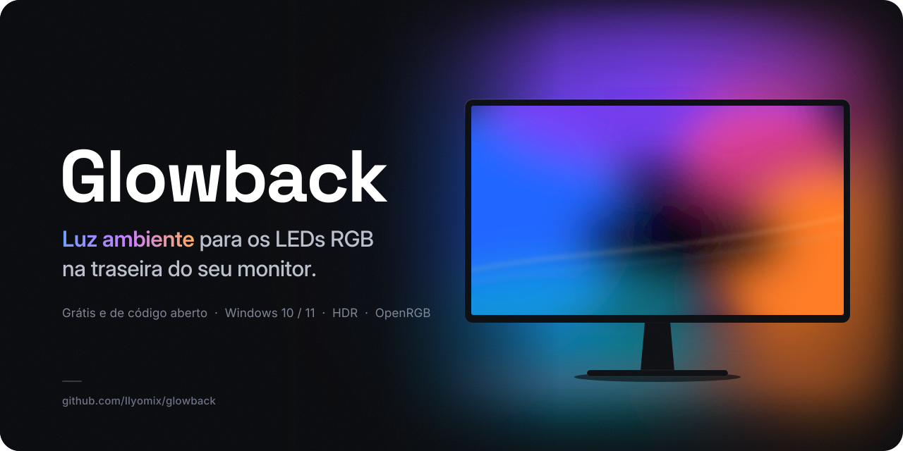

  

  <a href="README.md">English</a> · <a href="README.fr.md">Français</a> · <a href="README.es.md">Español</a> · <a href="README.de.md">Deutsch</a> · <a href="README.it.md">Italiano</a> · <b>Português</b>

<h1 align="center">Glowback: luz ambiente para monitores com LEDs RGB na traseira</h1>

  <b>Sincronização com a tela, gratuita e de código aberto, para os LEDs RGB na traseira do seu monitor.</b> 
  Cada LED acompanha a parte da imagem bem à sua frente, em tempo real. 
  Compatível com dispositivos de <b>Iluminação dinâmica do Windows 11</b> e <b>OpenRGB</b>. Sem fita LED, câmera ou software do fabricante.

  
  
  
  

---

Cada vez mais monitores gamer vêm com LEDs RGB na traseira, mas o software deles só oferece efeitos fixos, de respiração ou arco-íris. O **Glowback** transforma esses LEDs em uma **verdadeira luz ambiente**: ele captura a tela 30 vezes por segundo e dá **a cada LED sua própria cor**, tirada da borda da imagem bem à sua frente. Um pôr do sol à esquerda da tela deixa a parede da esquerda laranja.

O Glowback não depende de nenhuma marca: ele controla qualquer dispositivo que a **Iluminação dinâmica do Windows** (o padrão HID LampArray) ou o **[OpenRGB](https://openrgb.org)** consigam controlar: monitores, fitas LED, gabinetes, luminárias.

## ✨ Recursos

- 🎯 **Uma zona por LED**, projetada na borda da tela mais próxima. Também há um modo de cor média única.
- 🎬 **Filmes, jogos e HDR**: captura pela GPU (DXGI) em tela cheia, compatível com HDR, **ignora as barras pretas**.
- 💡 **Cores brilhantes e fiéis**, mesmo em cenas escuras.
- 🪟 **Um app de Windows de verdade**: uma janela com uma prévia ao vivo dos seus LEDs, ajustes rápidos pelo ícone ao lado do relógio, instalador, menu Iniciar, inicialização com o Windows e desinstalação limpa em *Configurações → Aplicativos*.
- 🎨 **Cores, degradês e música**: além da tela, uma cor, um degradê (parado ou em movimento), ou LEDs que seguem o som do seu PC: pulso, espectro ou ondas.
- 🌙 **Perfis**: uma luz mais suave à noite, nos horários que você escolher, e um clima para cada app: música enquanto o Spotify toca, a tela para os jogos, azul no seu editor de código.
- 🔄 **Aviso de atualizações** uma vez por dia (pode ser desativado).
- 📱 **App Casa da Apple, Google Home e Alexa, sem Home Assistant**: com Matter, o Glowback é uma luz no app Casa do celular. Página *Apple e Google* do Glowback; guia no [README em inglês](README.md#-apple-home-google-home-and-alexa).
- 🏠 **Home Assistant, Google Assistente, Alexa e Siri**: o Glowback aparece como uma luz controlada pelos painéis, automações ou por voz.
- 🌍 **6 idiomas**, conforme o idioma do Windows.
- 🔌 **Plug and play**: detecta automaticamente dispositivos de Iluminação dinâmica e o OpenRGB.
- 🪶 **Leve**: cerca de 0,5 ms de CPU por quadro.

## 🚀 Instalação

1. **Conecte o cabo USB upstream do monitor** ao PC (USB-B ou USB-C).
2. **Desative a Iluminação dinâmica do Windows para esse dispositivo**: *Configurações → Personalização → Iluminação dinâmica → seu dispositivo → "Usar a Iluminação dinâmica nos meus dispositivos" → Desativado*.
3. **Baixe o [GlowbackSetup.exe](https://github.com/Ilyomix/glowback/releases/latest/download/GlowbackSetup.exe)** e siga o assistente (não precisa de permissão de administrador).

> O Windows SmartScreen pode avisar sobre um editor desconhecido porque o app ainda não é assinado: *Mais informações → Executar assim mesmo*. [Política de assinatura de código](CODE_SIGNING.md) · [Privacidade](PRIVACY.md)

Para conferir a orientação dos LEDs: *menu Iniciar → Ferramentas do Glowback → Testar os LEDs* (esquerda vermelha, direita azul).

## ✅ Meu monitor funciona?

Sim, se **uma** destas condições for verdadeira:

1. **Ele aparece no Windows** em *Configurações → Personalização → Iluminação dinâmica*.
2. **Ele é compatível com o [OpenRGB](https://openrgb.org)**: abra o OpenRGB com o servidor SDK e o Glowback o detecta sozinho.
3. **Nenhuma das duas?** Adicione uma fita LED com uma placa RP2040 de 5 US$: [guia DIY](docs/DIY-LED-strip.md) (em inglês).

Testado com: AOC AGON PRO AG276QZD2 (47 LEDs). Funciona no seu monitor? [Conte para nós](https://github.com/Ilyomix/glowback/issues/new?template=device-report.yml).

## 🪟 O app

Ao abrir o Glowback pelo menu Iniciar, a janela dele aparece: **Luz ambiente** (prévia ao vivo da sua tela e dos seus LEDs, liga/desliga, clima, brilho), **Perfis**, **Home Assistant**, **Configurações** (iniciar com o Windows, atualizações, idioma) e **Sobre**. Ao fechá-la, o Glowback continua em segundo plano: clique duas vezes no ícone dele ao lado do relógio para reabri-la, ou uma vez para o painel rápido.

## 🎨 Climas e perfis

Na página **Luz ambiente**, escolha o que os LEDs mostram: a **tela** (cada LED a sua zona, ou uma cor média), uma **cor**, um **degradê** (de 2 a 4 cores, parado ou em movimento) ou a **música**: os LEDs seguem o som que o seu PC toca (pulso, espectro ou ondas), sem microfone e sem gravar nada. Na página **Perfis**, o clima muda sozinho: um **perfil noturno** (horário, brilho e clima), um clima **por app** (enquanto está aberto, em primeiro plano, em tela cheia ou tocando som) e o que fazer **no resto do tempo**. Por exemplo: música enquanto o Spotify toca, a tela para os jogos em tela cheia. [Guia completo (em inglês)](README.md#-looks).

## 🏠 Home Assistant e Google Assistente

O Glowback pode aparecer no Home Assistant como uma luz (liga/desliga, brilho, cor e modo), controlada pelos painéis, pelas automações, pelo Google Assistente, pela Alexa e pela Siri (app Casa da Apple, com a integração HomeKit Bridge do Home Assistant). Instale o app **Mosquitto broker** no Home Assistant e, no painel do Glowback, clique em **Home Assistant** e informe o endereço, o usuário e a senha. [Guia completo (em inglês)](README.md#-home-assistant--google-assistant).

## 🗑️ Desinstalar

- **Instalador**: *Configurações → Aplicativos → Aplicativos instalados → Glowback → Desinstalar*. Os LEDs voltam ao efeito do dispositivo.
- **Versão Python**: `glowback --uninstall` e depois `pip uninstall glowback`.
- **Portátil**: `glowback.exe --uninstall` e depois apague os arquivos .exe.

## ❓ Perguntas frequentes

**Quais monitores são compatíveis?** Qualquer monitor cuja iluminação RGB traseira possa ser controlada pela Iluminação dinâmica do Windows ou pelo OpenRGB. Confira com `glowback --list`.

**Funciona com HDR, jogos e filmes em tela cheia?** Sim. Conteúdos protegidos por DRM geralmente aparecem pretos para qualquer ferramenta de captura.

**Nada acende.** Verifique o cabo USB do monitor, se o RGB está ativado no menu do monitor e se a Iluminação dinâmica do Windows está desativada para esse dispositivo.

**As cores estão do lado errado.** Use *Testar os LEDs*; se esquerda e direita estiverem invertidas, adicione `--mirror`.

Opções de linha de comando e detalhes técnicos: [README em inglês](README.md#%EF%B8%8F-command-line).

## ⭐ Apoio

Se o Glowback iluminou sua mesa, **dê uma estrela ao repositório**: isso ajuda outros donos de monitores RGB a encontrá-lo.

---

Ambilight é uma marca da Koninklijke Philips N.V. / TP Vision. O Glowback é um projeto de código aberto independente, sem vínculo com eles.

MIT © [Ilyomix](https://github.com/Ilyomix) · [Política de assinatura de código](CODE_SIGNING.md) · [Privacidade](PRIVACY.md)
